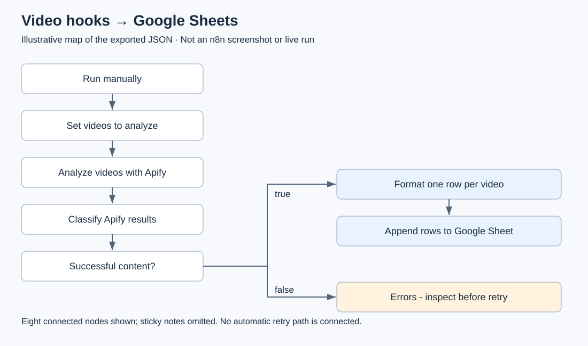

# Video hooks to Google Sheets: connection map

Use this map to see where content rows and diagnostics separate before importing the [existing n8n template](video-hooks-shot-lists-to-sheets.json). It is an illustration of the exported JSON connections, not an n8n screenshot or a live execution result. Sticky notes are omitted; all eight connected nodes are shown.

## Read the paths

1. **Run manually → Set videos to analyze → Analyze videos with Apify.** Replace the example video links and review `outputLanguage`. The request enables `includeTranscript: true`; a valid visual analysis may still have no transcript.
2. **Classify Apify results → Successful content?** The classifier checks the response and formatting. Admitted content has `status: ok`, a nonempty summary, and no error/errorCode. HTTP success alone is insufficient.
3. **True → Format one row per video → Append rows to Google Sheet.** The formatter maps fields including hook, summary, structure, key moments, CTA and available transcript. The output is one row per video, not one row per shot. Use it for human review, not as evidence that an ad performs well.
4. **False → Errors - inspect before retry.** Failed, malformed or timed-out responses stay out of the content sheet. This terminal inspection branch does not retry, poll or recover automatically. Check any available run/dataset identifiers before retrying; a timeout does not prove execution stopped.

## Before running

Configure Apify Header Auth in n8n credentials, connect your Google account, select your own spreadsheet and create the exact headers listed in the template's **Template overview** note. Do not put tokens in exported JSON. Read the [setup, costs and retry notes](README.md#before-you-run) before execution.

The template download is free; execution can incur Actor, platform, AI and other connected-service charges. A waived result fee does not waive every cost. Review [Video Breakdown AI's current pricing](https://apify.com/tubetext/video-breakdown-ai/pricing). The synchronous endpoint has a [300-second response limit](https://docs.apify.com/api/v2/actor-run-sync-get-dataset-items-post), so start small and check an existing run before repeating work.

TubeText maintains the paid Actor used by this example. This guide explains source structure only; it does not establish live end-to-end reliability or measured cost savings. For the scope of the reported offline checks, see the [template README](README.md#hooks-and-shot-lists-successful-analyses-only).
